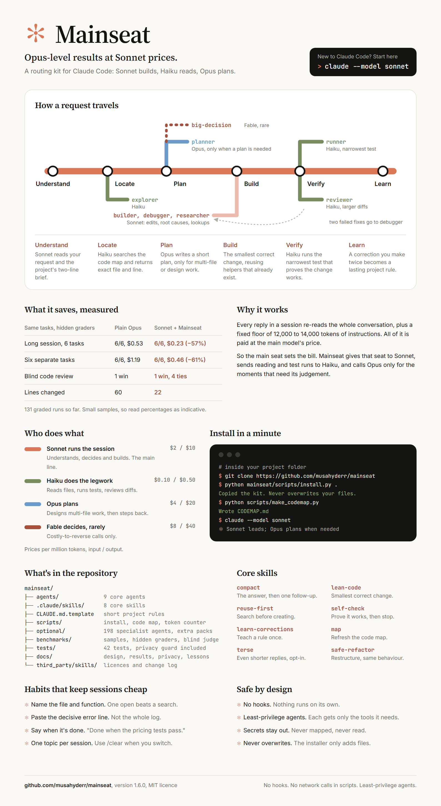

# Mainseat

<p align="center">
  
</p>

**Opus-quality results at Sonnet prices.** The model in the main seat of a Claude Code
session sets the price of every turn. Mainseat puts Sonnet there, hands reading and test
runs to Haiku, and calls Opus only when a plan is needed.

> **Recommended:** run your main session on **Sonnet** (`claude --model sonnet`).

| Measured on identical tasks | Plain Opus | Sonnet + Mainseat |
|---|---|---|
| Tasks passed (hidden graders) | 10/10 | **10/10** |
| Cost, 6 real-size tasks | $1.12 | **$0.49 (-56%)** |
| Cost, 4 small tasks | $0.59 | **$0.33 (-44%)** |
| Lines changed, feature task | 22 | **6** |
| Long session, 6 tasks in one conversation | $0.53 | **$0.23 (-57%)** |
| Blind code review (6 pairs, Opus as reviewer) | 1 win | **1 win, 4 ties** |

101 graded benchmark runs so far; one failed, exposing a defect that is now fixed.
Method and raw numbers: [docs/BENCHMARK.md](docs/BENCHMARK.md).

## Start in one minute
```bash
git clone https://github.com/hydersmiling/mainseat
python mainseat/scripts/install.py path/to/project
claude --model sonnet
```
Fill in the two lines at the top of the new `CLAUDE.md`, then run `python scripts/make_codemap.py`.
The installer never overwrites your files.

## How it works
1. **Understand.** Sonnet reads your request and the project's rules.
2. **Locate.** A Haiku `explorer` checks the code map and returns `path:line` citations.
3. **Plan.** For multi-file or design work, the Opus `planner` returns a short numbered plan.
4. **Build.** Sonnet makes the smallest change that solves it, reusing existing helpers.
5. **Verify.** A Haiku `runner` runs the narrowest test; two failed fixes go to `debugger`.
6. **Learn.** Correct the same thing twice and it becomes a rule in `.claude/LEARNED.md`.

| Role | Model | Why |
|---|---|---|
| Main session: understands, decides, edits known files | **Sonnet** | Every reply re-reads the whole context, so this seat sets the price |
| `planner`: designs multi-file work | Opus | Strongest reasoning, used only when a plan is needed |
| `explorer`, `runner`, `reviewer`: read, search, run tests, review | Haiku | 40x cheaper than Opus for mechanical work |
| `builder`, `debugger`, `researcher`: edits, root causes, docs lookups | Sonnet | Capable at half Opus's price |
| `big-decision`: costly-to-reverse choices | Fable | Rare; falls back to Opus if unavailable |

## What you get
- **Code map:** a one-line summary of every file; secrets and ignored files left out.
- **Reuse before create:** searches the map and existing helpers before writing new code.
- **Smallest correct change:** only what you asked for, verified by the narrowest test.
- **Self-debugging:** two failed fixes hand over to a debugger instead of looping.
- **Learns your corrections:** say it twice and it becomes a project rule.
- **Compact replies:** the answer, then at most one short follow-up.
- **200+ agents:** 8 core plus 198 optional specialists (`--list-agents`, `--agents NAME`).
- **Real numbers:** `scripts/measure_tokens.py` shows what any session cost, subagents included.

## What to use
| You want | Use |
|---|---|
| Opus-level results for less | `claude --model sonnet` + Mainseat |
| The lowest cost on simple work | `claude --model haiku` + Mainseat (passed every small task: $0.02 for four) |
| A hard design or architecture call | Let the session call `planner` or `big-decision` |
| A large codebase | `install.py --with code-graph` |

## Installation options
```bash
python scripts/install.py PATH --dry-run              # preview; changes nothing
python scripts/install.py PATH                        # core kit
python scripts/install.py PATH --with dev-essentials  # debugging, review, git and testing skills
python scripts/install.py PATH --with code-graph      # knowledge graph for large repositories
python scripts/install.py --list-agents               # browse the 198 catalog agents
python scripts/install.py PATH --agents security-auditor backend-architect
```
Anything the installer skips is listed so you can merge it by hand.

## Measure your own sessions
```bash
python scripts/measure_tokens.py              # the latest session in this folder
python scripts/measure_tokens.py --last 5     # the last five
```
It reports tokens per model and how much of each reply was the fixed floor of context.
Everything is read from Claude Code's local logs; nothing leaves your machine.

## Customise
- **Project rules** live in `CLAUDE.md`. Keep it short: it is read on every turn.
- **Learned rules** live in `.claude/LEARNED.md`. Edit or delete them freely.
- **Models** are set in the `model:` line of each file in `.claude/agents/`.
  Without Fable access, set `big-decision` to `opus`.
- **New agents** must declare `model:` and `tools:`; `python scripts/check_agents.py` catches typos.

## Honest limits
- Most of the saving comes from Sonnet in the main seat; plain Sonnet was cheaper still
  (-64%). Mainseat's rules cost about 20-30% on short tasks and buy smaller, reused,
  verified changes.
- One or two runs per setup so far, so treat the percentages as indicative.
- In the blind review the two setups tied overall; plain Opus was slightly stronger on
  correctness details (8.8 vs 8.5), Mainseat on keeping to the task (10 vs 8.7).
- For occasional one-off questions, a plain Sonnet session is cheaper.

## Safe by design
No hooks, no network calls in scripts, no permission bypass, least-privilege agents.
CI on Linux, Windows and macOS fails on leaked emails, personal paths or keys.
`main` is protected: every change goes through a pull request with passing checks.

## Repository
| Path | Purpose |
|---|---|
| `CLAUDE.md.template` | The short project rules the installer copies into your project |
| `.claude/agents/`, `.claude/skills/` | The eight core agents and eight core skills |
| `optional/` | The agent catalog and optional skill packs, installed only on request |
| `scripts/` | Installer, code map, token counter and header checker (standard-library Python) |
| `benchmarks/` | Sample projects, tasks, hidden graders, the runner and the blind judge |
| `tests/` | Unit tests, including privacy guards that run on every push |
| `docs/` | Guide, design, benchmark results, token tips, privacy and lessons learned |
| `third_party/` | Licences, notices and the change log for every borrowed file |

## Learn more
The [guide](docs/GUIDE.md) covers the reasoning behind the kit, a first-day walkthrough,
choosing a model, the agents and skills in depth, the FAQ, troubleshooting and team use.

[Guide](docs/GUIDE.md) · [Design](docs/DESIGN.md) · [Benchmark](docs/BENCHMARK.md) ·
[Token tips](docs/token-tips.md) · [MCP](docs/MCP.md) · [Privacy](docs/PRIVACY.md) ·
[Roadmap](docs/ROADMAP.md) · [Changelog](CHANGELOG.md) · [Inside .claude](.claude/README.md)

## Contributing
Every change reaches `main` through a pull request, and CI must pass on Linux, Windows and
macOS. Keep the code plain, commented Python with no dependencies. Back any savings claim
with a benchmark run and record its method in `docs/BENCHMARK.md`.

MIT licence. Mainseat includes skills and agents from other open-source projects under their
original licences; see [third_party/skills](third_party/skills/) for credits and every local change.
